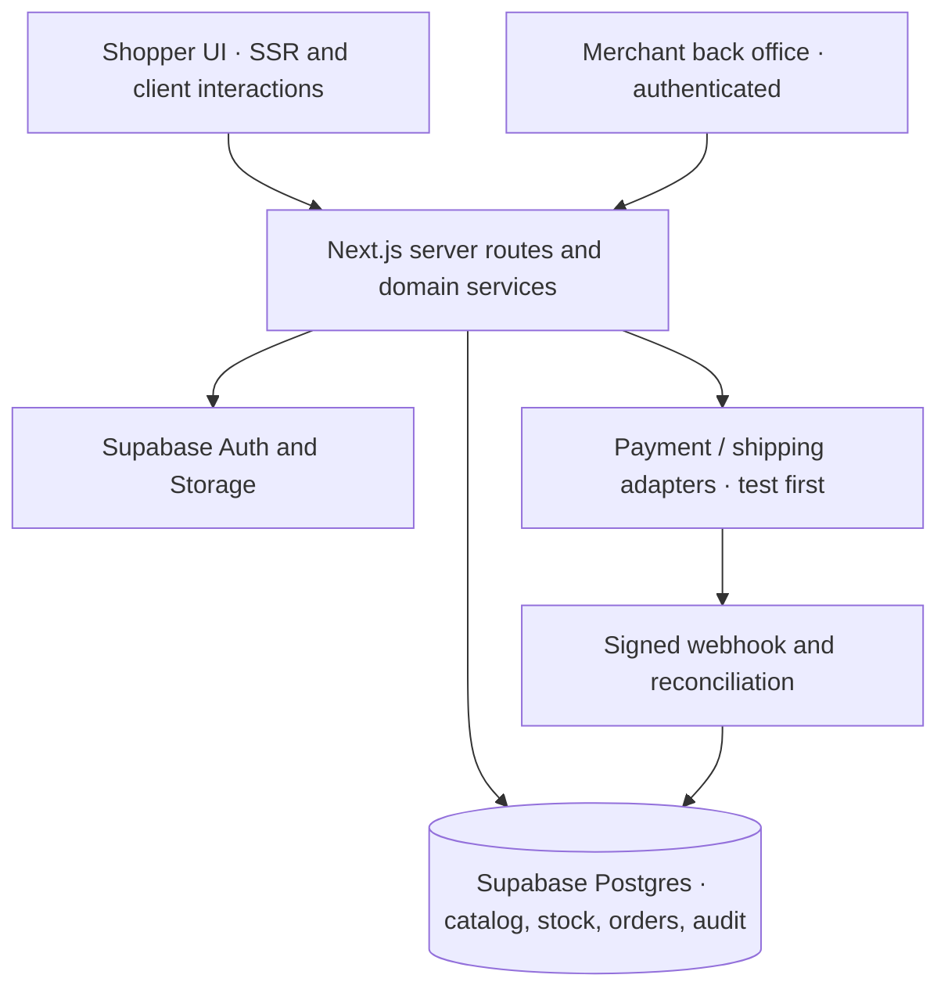
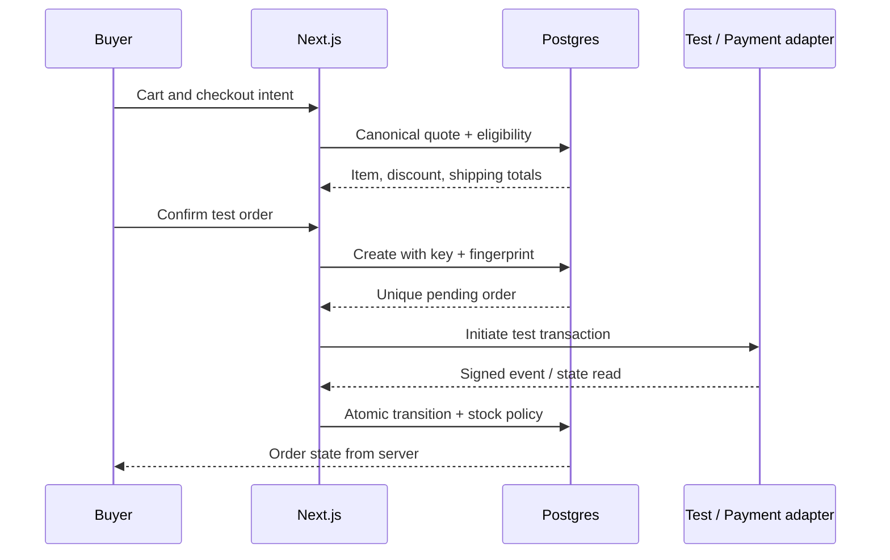

# Cauce Commerce Lab — Architecture for a real retail product

Status: **proposed target / design only** · 2026-11-21.
Baseline: `franciscovitar/la-mediterranea-store` `main` at `fe92357338b6a930280938e5c127b76ee519ae36`.
Intent: **evolve the original production-shaped Next.js application**, not rebuild another standalone JS simulator. All unimplemented paths below remain `PROPOSED`, not a description of deployed capabilities.

## Architectural decision

**Keep** Next.js App Router + TypeScript, Supabase Postgres/Auth/Storage, existing server checkout contracts and the Mercado Pago adapter behind configuration. Keep Vercel as the intended web host. This is a single fictional merchant, **not** an unnecessary multi-tenant marketplace or microservice suite.

Why: the source already has an actual transactional relational model, RLS, route handlers, admin, catalog and CI tests. A framework/platform rewrite would spend time reproducing existing quality rather than demonstrating new capability. A real client prioritizing time-to-market should also compare Shopify/WooCommerce before commissioning custom software; for this **personal full-stack engineering project**, extending the existing custom backend is a deliberate educational/product decision, not a universal recommendation.

## Component boundaries

**Browser:** discover, select, enter intent, render states; never owns prices, discounts, tax, stock, roles or payment truth.
**Server/domain:** validates input, chooses authoritative price/policy, enforces state transitions and idempotency, exposes narrow contracts.
**DB:** ACID constraints, stock reservation/transition, immutable order snapshots, uniqueness, audit/outbox and RLS.
**Provider adapters:** boundary isolation; a fake/test provider produces deterministic state **on the server** without charges. Later Mercado Pago uses signed events and provider reads, not query-string “success”.

## Current asset inventory: what is reusable

| Actual path | What the source currently provides | Reuse / required delta |
| --- | --- | --- |
| `app/page.tsx`, `components/Storefront.tsx` | Real storefront + category selection + persistent cart | Retain logic; debrand; split into home, collection and product page experiences; add search/sort; avoid one monolithic page |
| `components/ProductCard.tsx`, `CartDrawer.tsx` | Variant selection, quantity, add-to-cart, drawer | Reuse and harden max quantity/stock/keyboard; canonical thumbnails and responsive images |
| `lib/commerce/cart.ts`, `checkout.ts`, `idempotency.ts` | Cart reconciliation, validated canonical quote logic, checkout request fingerprint | Preserve with regression tests; extend quote for shipping and promotions; assert invariants at DB boundary too |
| `app/api/checkout/{quote,create,status}` | Server endpoints for quote/order/status | Extend contract; add sandbox checkout without touching live provider; attach order lifecycle and test tracking |
| `supabase/migrations/20260920_001_commerce.sql` | Products, colors, sizes, optional tracked stock, orders, items, payment events and checkout RPCs | **Additive** migration only; introduce collections/media, SKU metadata, promotions, independent fulfillment status, inventory event ledger and audit trail |
| `supabase/migrations/*security*`, `lib/admin/auth.ts` | RLS/admin authorization, storage policies | Keep; extend role matrix and negative-case tests before adding merchant capabilities |
| `components/AdminPanel.tsx`, `/api/admin/*` | Catalog, inventory, orders, integrations, backup/restore | Preserve functions; separate dashboard/catalog/inventory/orders/fulfillment and validate role-gated actions |
| `lib/integrations/mercadopago/server.ts`, `/api/webhooks/mercadopago` | Prepared Checkout Pro Orders + signed notification boundary | Keep **inactive**; adapter interface allows deterministic test provider and isolated contract tests |
| `data/products.json`, `supabase/seed.sql`, `/public/products`, `/public/brand` | Historical La Mediterránea merchandise and brand | Replace rendered/seeded public data with independent Cauce catalog and rights-clear assets; retain historic files only for provenance |
| `tests/`, `showcase/model.test.mjs`, `.github/workflows/ci.yml` | Backend helper tests, catalog/check/build gate, 20 standalone synthetic model tests | Retain all; add DB/API/E2E tests against real app. Separate synthetic model evidence from real runtime evidence |

No migration, SQL schema, provider, permission or live catalog has been changed by this architecture note.

## Domain model and authority

**Existing actual tables:** `products`, `product_colors`, `product_sizes`, `inventory`, `admin_users`, `orders`, `order_items`, `payment_events`. `products.price` is numeric; order items already snapshot name, quantity and unit price. Inventory rows are optional: an absent row means **untracked**, not zero. `admin_users` currently expresses one administrator role; don't call it full RBAC.

**Target additions** — migration designs only, each with explicit backfill/rollback/test:

| Capability | Additive model | Avoid duplicating existing authority |
| --- | --- | --- |
| Curated catalog | `collections`, `product_collections`, `product_media`, SEO slug/metadata | `products` stays canonical for active/status/price; photos have author/license/alt metadata |
| SKU identity | Stable per purchasable color/size combination; consider `product_variants` only after characterization tests | Do **not** create competing product and variant prices/stock columns silently; transition from tuple key explicitly |
| Inventory | `inventory_movements` and optional `stock_reservations` with expiry | DB row/transaction is authority; frontend stock badge is only a view |
| Promotions | `promotions`, `promotion_redemptions` plus eligibility/usage limit | Server quote validates discount and uses stable numeric monetary values |
| Fulfillment | `fulfillment_status`, shipment/tracking metadata, `order_status_events` | Separate payment status from fulfillment, returns and customer display |
| Audit and async events | `audit_entries`, `outbox_events` (if genuine async emails/notifications are needed) | Neither the client nor a volatile serverless timer is durable event authority |
| Customers | Optional `customer_profiles`, guest `order_access_tokens` with hashed expiry | Do not make buyer emails searchable publicly or require an account to purchase |

Design rule: no newly added table may expose guest PII or privileged writes. Review grants and RLS `SELECT/INSERT/UPDATE/DELETE` cases by role, and test them before enabling the API. `service_role`/server secret never ships to the browser.

## Non-negotiable commerce invariants

1. **Canonical quote:** Only active purchasable SKUs at current server price; dedupe cart lines; validate options, max quantity, shipping zone and promotion conditions. Snapshots of unit price, discount, shipping and currency belong to the order at creation.
2. **Replay-safe creation:** One idempotency key + request fingerprint identifies a given checkout. Same key + same body returns the existing result; **same key + different body is 409**, not silent reuse. The existing RPC returns by request ID; add DB-level fingerprint guard before claiming this behavior under hostile requests.
3. **No oversell:** The current provider event RPC locks the `orders` row but reads `inventory.stock` without an explicit row lock/conditional decrement. Different orders for the final unit require concurrency tests and a chosen inventory policy. Proposed options: (A) reserve stock atomically with expiry on order creation; (B) decrement atomically on accredited payment with manual exception for an already-paid stock conflict. Do not claim either is implemented. For the first business-grade slice, choose and test one policy before public checkout.
4. **Payment truth:** Browser redirects don't mark paid. Verify signature and look up provider state/amount/reference server-side. Deduplicate callbacks by stable event ID and protect order transitions against duplicates and reordering. `payment_review` requires an operator resolution path.
5. **Separate lifecycles:** Payment (`unpaid/pending/paid/refunded/...`) and fulfillment (`unfulfilled/picking/packed/shipped/delivered/...`) are independent. Refunds/returns and restocking are explicit business events, never implicit on page load.
6. **Admin and customer isolation:** RLS plus server authorization on every command; customer order lookup requires ownership or a scoped signed/opaque token. No administrative mutation from a public demo role.
7. **Consistency under partial failure:** Use transactions for stock/order updates and a durable outbox for post-commit side effects if notifications arrive. Failed email must not roll back a paid order; retries must not issue duplicate messages.

## Proposed buyer request sequence

This diagram specifies **target behavior**, not observed end-to-end operation in Cauce today. The real Mercado Pago provider remains intentionally inactive. In a public sandbox, test provider transitions must be server-side and only affect isolated synthetic records.

## Public-demo operating mode

- A **consumer-visible fictional shop** and a **separate, permissioned merchant console**. No architecture explanation overlay, fake server badges or runnable failure scripts mixed into the shop's storefront.
- An isolated database namespace/environment with bounded seed, expiry/reset and write quotas. Do not point the public recruiter site at an actual prospect/client production DB.
- Role-based sample accounts or explicitly scoped sessions; admin writes do not leak between unrelated visitors. Prefer per-session isolated fixtures or a resettable tenancy boundary only if it adds manageable complexity.
- No real card details, charge, fulfillment, email, analytics PII or shipping API until separately authorized. Show `Entorno de prueba` at the transaction boundary rather than pretending a live business.
- Preserve the existing hosted `showcase/` during migration. Cutover only after QA; optionally move the pure scenarios into `/lab` (not primary nav) or keep them in the repo tests.

## Frontend and operability

- Product index/collection with SSR/metadata and shareable query filters; customer interactions hydrate only where necessary. Split the current monolithic client `Storefront` into focused components and avoid serial data-fetch waterfalls.
- Product detail uses stable canonical URL, accessible selectable variants and explicit stock; responsive image pipeline, truthful alternatives, keyboard and reduced-motion support.
- Checkout is guest-friendly, minimal-field, autofill-friendly, clearly displays shipping/total/return terms, and handles reload/retry without a second order.
- Admin uses honest async/loading/error/permission states and audit activity, not raw JSON debug surfaces.
- Verify LCP, INP and CLS on a representative mobile connection; record measured values rather than inventing scores. Add `Product`/`ProductGroup` metadata only for published purchasable variants.

## Implementation strategy and QA gates

| Milestone | Build increment | Evidence required before merge/cutover |
| --- | --- | --- |
| M0 — Characterize | Baseline catalog/order tests, UX screenshots and current SQL/RLS contract; source of existing assets | Existing tests still pass; no unauthorized DB writes |
| M1 — Brand and browse | New Cauce seed/assets, home, collection, PDP, search/filter/sort, cart | Mobile/keyboard/empty-state journeys and product metadata verified; historical assets absent from public render |
| M2 — Operate | Split admin, product/stock management, order list/state, scoped test data | Admin/guest negative tests; inventory changes reflected in public catalog |
| M3 — Transaction safety | Checkout test provider, stable quote, idempotency fingerprint enforcement, inventory policy, shipping/discount | Concurrent last-unit test; replay/conflict tests; no money movement; order reconciliation |
| M4 — Complete lifecycle | Fulfillment, controlled return/refund simulation, audit, exports and merchant analytics | State-machine tests, reset/recovery and no double-event side effect |
| M5 — Release | Production-like seeded public experience, SEO, accessibility, perf, responsive, Vercel deploy | Local CI green first; bounded deploy + readback; actual browser E2E and portfolio claim update |

**Engineering execution order:** characterize -> additive schema -> backend tests -> API -> UI vertical slice -> E2E -> bounded deployment. Do not use Vercel Preview or GitHub Actions as a repeated diagnostic runner; run equivalent local tests before one coherent push.

## Alternatives and tradeoffs

| Choice | Strength | Weakness / decision |
| --- | --- | --- |
| Keep custom Next.js + Supabase | Reuses implemented domain logic, permits fine-grained testing/portfolio proof | More maintenance and security responsibility; **chosen for this personal engineering project** |
| Shopify | Hosted checkout, rich cart/discount/delivery/order primitives; lower merchant integration burden | Less direct evidence of custom transaction and database engineering; **revisit for a paying merchant with ordinary retail needs** |
| WooCommerce | Flexible CMS/catalog plugins, broad merchant ecosystem | Upgrade/plugin/security operations; no justification for migrating this existing codebase now |
| New microservices/message bus | Independent scaling boundaries eventually | Adds distributed failure, cost and migration with no demonstrated need; **defer** |

## Open decisions (not invented)

1. Product taxonomy and licensed visual assets beyond the provisional Cauce lifestyle objects identity.
2. Stock reservation versus pay-time atomic debit; exact expired-payment/late-callback policy.
3. Test checkout provider and seeded isolation mechanism; genuine persistence must be verified before public claim.
4. Shipping zones/tax rules for a fictional Argentine merchant; never invent legal/fiscal compliance or carrier quotes.
5. Optional shopper login versus token-based tracking; privacy/retention commitments.
6. Real payments, email delivery, domain cutover, paid infrastructure and live DB migrations require future explicit approval.

Sources/research decisions: [FEATURE_RESEARCH_20261121.md](FEATURE_RESEARCH_20261121.md). Product contract: [PRODUCT_DIRECTION_V2.md](PRODUCT_DIRECTION_V2.md).
